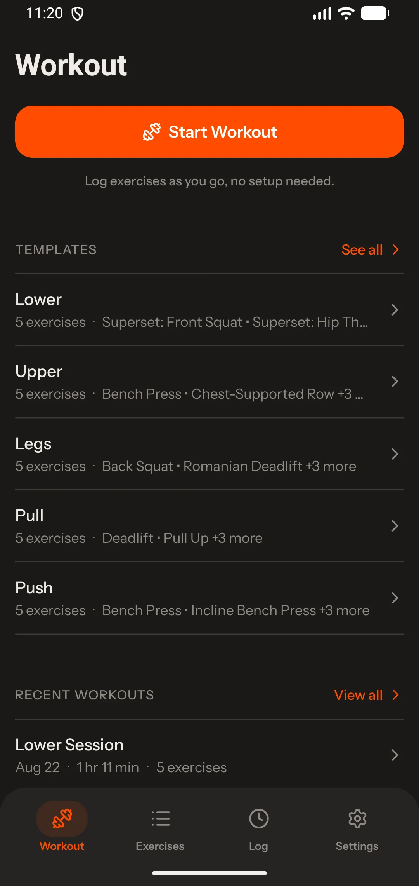
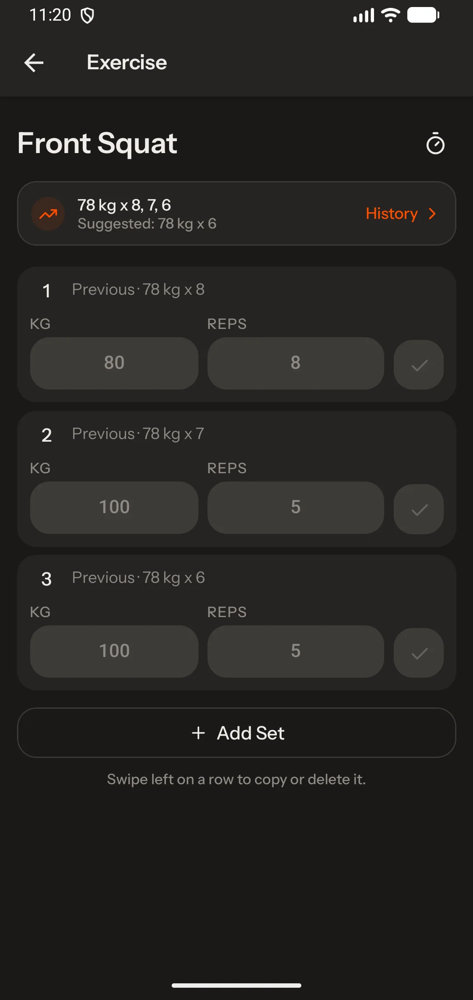
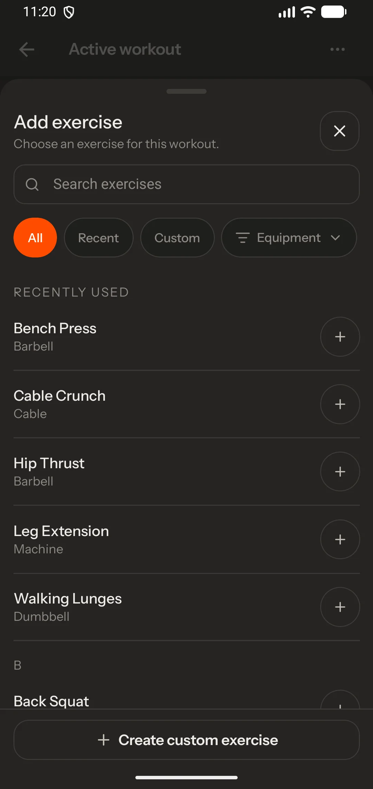
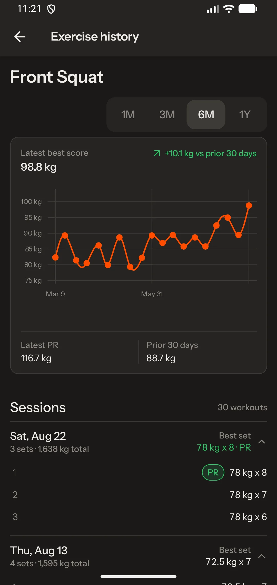
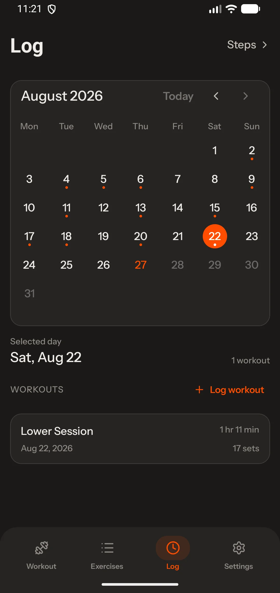

# LiftLog

LiftLog is a local-first workout tracker for iOS and Android. It is designed for fast strength and hypertrophy logging without an account, with workout data stored on the device in SQLite.

## Features

- Start, resume, and complete workouts, or add and edit workouts from history
- Track sets by weight, reps, distance, or duration across six tracking modes
- Reorder exercises, group supersets, and review exercise history while training
- Use reusable workout templates and progression suggestions
- Run rest timers with presets, haptics, audio, and optional Android notifications
- Review workout history, personal records, and exercise progress charts
- Search the built-in exercise library and manage custom exercises
- Export, import, preview, and undo JSON backup restores
- Choose light, dark, or system theme and kilograms or pounds
- On Android, sync daily steps from Health Connect and install signed updates from GitHub Releases

## Screenshots

<p align="center">
  
  
  
  
  
</p>

## Stack

- Expo 54 and React Native 0.81
- React 19 and TypeScript
- Expo Router with typed file-based routes
- NativeWind 5 and Tailwind CSS 4
- Expo SQLite and Drizzle ORM
- Gorhom Bottom Sheet, Reanimated, Skia, and Victory Native
- Sentry for production diagnostics

## Requirements

- Node.js 22.13.0 or newer (the repository includes `.nvmrc`)
- pnpm 9.1.1
- Xcode and CocoaPods for iOS development
- Android Studio and the Android SDK for Android development

LiftLog uses native modules, including local Android modules for exact alarms and app updates. Use a native development build rather than Expo Go.

## Local development

Install dependencies:

```sh
pnpm install
```

Build and launch the app for a simulator, emulator, or connected device:

```sh
pnpm ios
pnpm android
```

To start Metro separately for an existing development build:

```sh
pnpm start
```

Health Connect, exact-alarm handling, and in-app updates are Android-specific. Core workout tracking and backup features work on both supported platforms.

## Quality checks

```sh
pnpm run ts-check         # TypeScript
pnpm test                 # Node test suite
pnpm run lint             # ESLint
pnpm run prettier:check   # Formatting
pnpm exec knip            # Unused files and exports (advisory in CI)
```

`pnpm run format` applies Prettier, while `pnpm run lint:fix` applies ESLint fixes. Pull requests and pushes to `main` run type checking, tests, linting, and formatting in GitHub Actions.

## Project structure

```text
src/
  app/          Expo Router routes
  components/   Shared UI primitives and styled native wrappers
  db/           SQLite schema, startup migrations, and seed data
  features/     Workouts, exercises, progress, rest timers, steps, backups, updates, and settings
  lib/          Cross-feature utilities and platform services
  providers/    App-level database, theme, error, and runtime providers
  theme/        Theme tokens, fonts, and preferences
modules/        Local Expo native modules
plugins/        Expo config plugins
scripts/        Release preparation, build, and verification tooling
tests/          Unit, integration, and release-configuration tests
```

The app initializes SQLite, runs committed Drizzle migrations, and seeds the exercise library at startup. `src/db/schema.ts` is the schema source; migration SQL and snapshots are generated artifacts and should not be edited by hand.

## Android releases

Android releases are produced from `v*.*.*` tags. From a clean, up-to-date `main` branch, prepare a version with:

```sh
pnpm release:prepare patch
```

`minor` and `major` are also supported. The command runs the quality checks, updates the package and app versions, increments the Android version code, then creates a commit and tag without pushing them. Pushing the commit and tag triggers the release workflow, which builds and verifies a signed ARM64 APK plus its update manifest before publishing a GitHub Release.

Release signing credentials and recovery requirements are documented in [`docs/android-release-signing.md`](docs/android-release-signing.md).

## Contributing

Use Conventional Commits scoped to the relevant GitHub issue. See [`docs/commits.md`](docs/commits.md) for the repository conventions.
